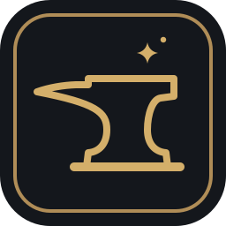
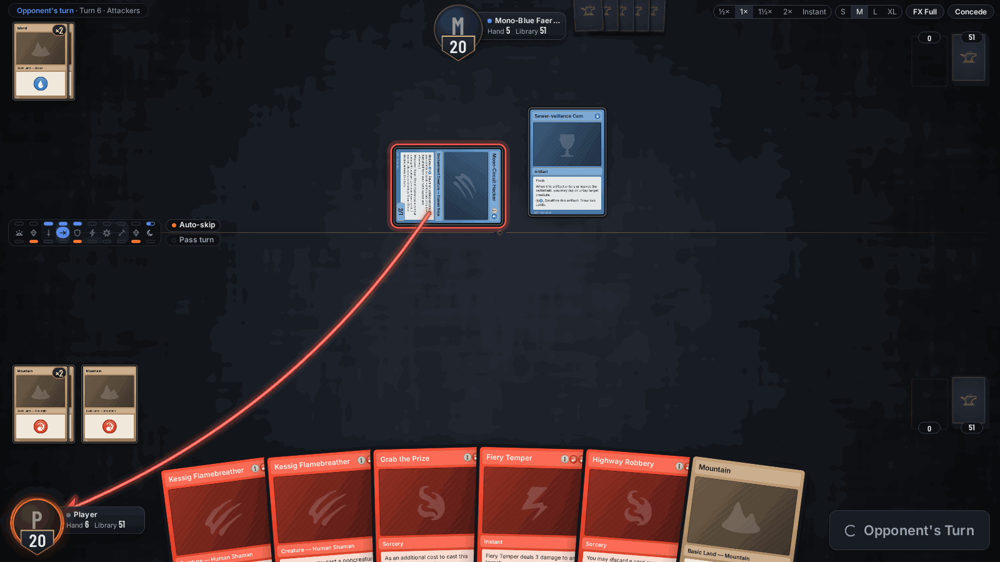
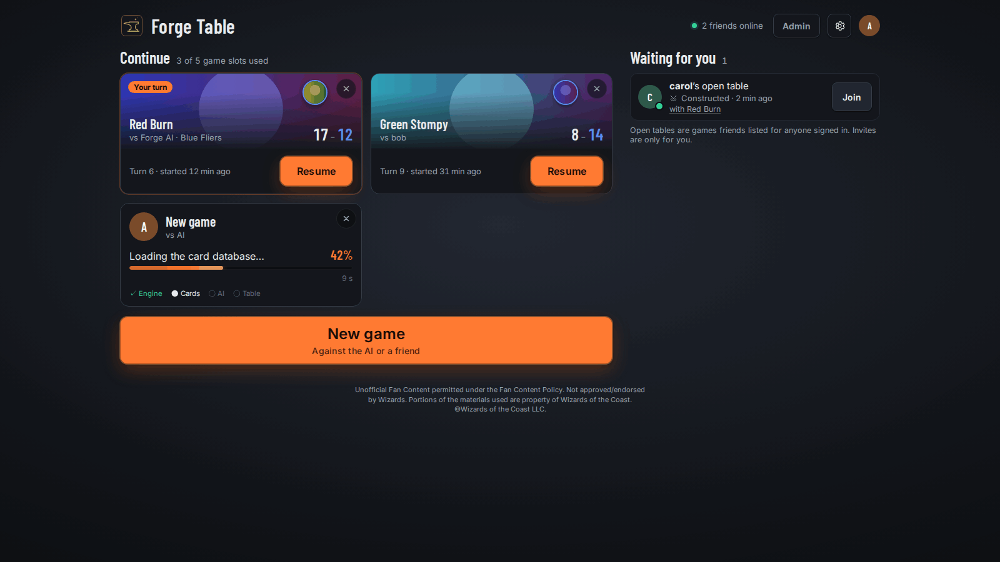
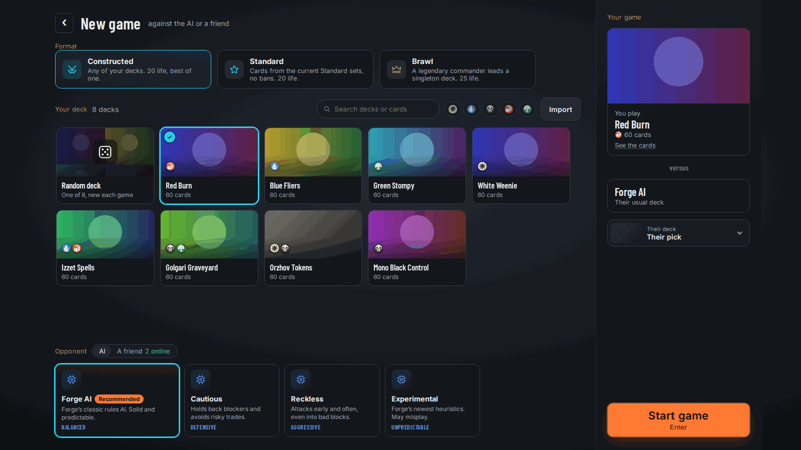
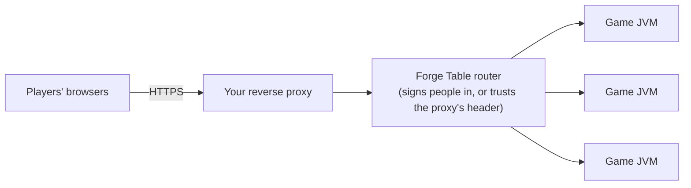

<h1> Forge Table</h1>

Forge Table lets you play Magic: The Gathering in a web browser, against the computer or against friends, on a server you run yourself.

> **Forge Table is alpha software.** It plays real games, but expect bugs and rough edges, and expect settings,
> saved data and the plugin interface to change between releases without a migration path. Bug reports and feature
> requests are welcome.



Forge Table is its own product. The rules come from [Forge](https://github.com/Card-Forge/forge), the open-source
Magic rules engine, which runs inside the server; the table you play on, the lobby, the multi-game server and the
deployment story are Forge Table's. It isn't affiliated with the Forge project or with Wizards of the Coast (see
[NOTICE](NOTICE)).

## What you need

- Java 17 or newer on the machine that runs the server (CI and the Docker image use 21).
- About 1.5 GB of free RAM per game that's running at the same time.
- A browser with WebGL. The test suite runs in Chromium; other current browsers should work but aren't tested.
- Internet access, but only if you want card art. The server fetches it from Scryfall on demand. Games themselves
  work offline.

To host for a group you also need a reverse proxy with TLS in front. Who signs people in is up to you: Forge
Table's own accounts, your OpenID Connect provider, or a login proxy.

## Your first game

Nothing to configure for one player on your own computer.

1. Download the latest `forge-table-<build>.zip` from the
   [Releases page](https://github.com/mdbook/forge-table/releases) and unzip it.
2. Run `./launch.sh` (Linux, macOS) or `launch.cmd` (Windows, with `java` on the `PATH`).
3. Your browser opens on the start screen after 30 to 45 seconds. Pick your deck and an opponent from the bundled
   ones, then press Start.

Everything it saves, from imported decks to the card-art cache, goes in `user/` next to the launcher. The server
listens on `127.0.0.1` only and the link it opens carries a random token, so nobody else on your network can join. With `./launch.sh --card-art off` the server fetches no card art at all.

### Or with Docker (Linux)

The image is built from the same release zip:

```sh
git clone https://github.com/mdbook/forge-table.git && cd forge-table
mkdir -p forge-gui-bridge/target/dist
cp ~/Downloads/forge-table-*.zip forge-gui-bridge/target/dist/
docker build -t forge-table -f forge-gui-bridge/docker/Dockerfile \
  --build-arg ZIP=target/dist/forge-table-<build>.zip forge-gui-bridge
docker run -d --name forge-table --network host -e FT_BIND=127.0.0.1 -v forge-table:/data forge-table
docker logs forge-table 2>&1 | grep FORGE_TABLE_READY
```

Open the `url` from that line (it ends in `#t=<token>`). This runs the multi-game server with its lobby, for you
alone on the host's loopback.

## Playing with friends

The multi-game server (router mode) gives everyone a lobby, runs each game in its own JVM and lets two people play
each other. Pick how people sign in with `FT_AUTH`:

| `FT_AUTH` | Who signs people in | You also set |
|---|---|---|
| `users` | Forge Table: its own sign-in page and accounts you make from the command line | `FT_REAL_IP_HEADER` |
| `oidc` | Your OpenID Connect provider (Authentik, Keycloak, Authelia, Google and so on), through a "Sign in with" button | `FT_PUBLIC_URL`, `FT_OIDC_ISSUER`, `FT_OIDC_CLIENT_ID`, `FT_OIDC_CLIENT_SECRET_FILE` |
| `users,oidc` | Both, on one sign-in page | all of the above |
| `header` | A login proxy (oauth2-proxy, an Authentik outpost, Caddy `forward_auth`), which passes the user name in a header | `FT_TRUST_PROXY_HEADER`, e.g. `X-Forwarded-User` |



Whichever you pick:

- `FT_BIND`: the address your reverse proxy connects to. Loopback if the proxy runs on the same host, otherwise one
  private address. The Docker image picks its container address for you.
- Your proxy: TLS, and forward everything to the server, WebSockets included.
- Your firewall or Docker network: only the proxy may reach the server's port. In `header` mode that's the whole
  security story, since whoever reaches the port can claim to be anyone.



Admins, group restrictions, guest links and link previews are optional. [Hosting for a group](docs/forge-table/hosting.md)
walks through each sign-in mode with examples, and the checks to run before you open it up. For Docker,
[compose.yaml](forge-gui-bridge/docker/compose.yaml) is a ready oauth2-proxy stack and
[compose.solo.yaml](forge-gui-bridge/docker/compose.solo.yaml) runs it for you alone.



## Documentation

Everything else is in [docs/](docs/README.md): installing (release zip, Docker, from source), every setting, hosting,
card art, the Lyra neural opponent and the plugin hook behind her, building and testing, the architecture and a FAQ.

## Contributing

See [CONTRIBUTING.md](CONTRIBUTING.md). Bugs in how a card's rules work belong to Forge itself, at
[Card-Forge/forge](https://github.com/Card-Forge/forge/issues).

## Licence

GPL-3.0-only ([LICENSE](LICENSE)). The Forge engine it's built on is GPL-3.0-or-later, and its files keep their
notices. Card names and rules text are Wizards of the Coast's; Forge Table is unofficial Fan Content (see [NOTICE](NOTICE)). The card frame uses open (OFL) lookalike
fonts by default, and an operator can serve other fonts with [`--fonts`](docs/forge-table/configuration.md#files).
The original Forge README is kept at [docs/Forge-engine-README.md](docs/Forge-engine-README.md).
