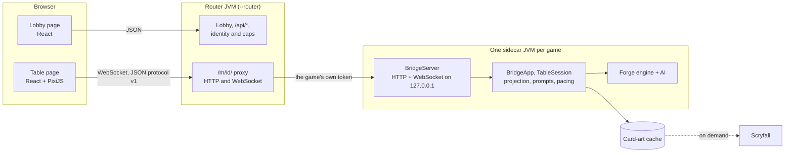

# Architecture

Forge Table has three parts. The browser client draws the table and sends the player's choices. A game server (the
"sidecar") runs one Forge match headless and turns it into messages for the client. The router, which is optional,
gives several people a lobby and runs each game as its own sidecar process.

Without the router, the browser talks to a single sidecar directly, and the left and middle boxes collapse into one
process.

## The browser client

`forge-gui-web/app` is a TypeScript app built with Vite. The lobby and every panel around the table are React; the
table itself is a PixiJS (WebGL) scene, so cards can move, stack and animate without the DOM. The game model is
built from the server's messages (`store/model.ts`); UI state is a small zustand store.

The client holds no rules. It shows what the server sends, highlights what the server says is playable, and sends
back acts and prompt answers. Card faces are drawn by the client from the card's data, optionally with art from the
server's `/img/card/` and `/img/crop/` endpoints.

`forge-gui-web/protocol` holds the message types, including properties generated from Forge's `TrackableProperty`.
`forge-gui-web/tests` holds the Playwright tests, which replay recorded sessions without a server.

## The sidecar

`forge.bridge.Main` boots Forge headless, with its own `IGuiBase` implementation in place of the desktop UI, and
starts a Netty HTTP and WebSocket server on `127.0.0.1`. It prints `FORGE_TABLE_READY {port, token, userDir, url}`
when it's ready.

- The first WebSocket frame must be a `hello` carrying the session token. Upgrades from a foreign `Origin` are
  refused.
- `ViewProjector` turns Forge's game view into the model one viewer is allowed to see. Hidden cards get opaque ids
  that change whenever they move or their library is shuffled, so the real id of a card you can't see never reaches
  your browser. Each update is a diff against what that viewer was last sent.
- `Outbox` gives every message for one viewer a sequence number under one lock. A client that reconnects gets a
  snapshot consistent with the last sequence number it saw.
- `PromptService` turns Forge's blocking GUI calls (choose a target, order triggers, pay a cost) into asynchronous
  prompts. Every answer is checked against the prompt it was made for, so a late or double click can't land on a
  prompt the player hasn't seen.
- `Pacer` holds the game thread back while the client is still animating, so the AI doesn't race ahead of what the
  player can see.
- `CardArtService` serves card images and art crops from its cache, fetching from Scryfall as needed.
- Only an allow-list of RPC methods is accepted (start a match, import a deck, settings and so on).

In a two-player game one sidecar holds both seats. Each seat has its own connection, prompts and projection, so each
player is only ever sent what their own seat may see.

## The router

`Router` is a second Netty server in the same jar, started with `--router`. It doesn't boot the Forge engine; it
reads a few of Forge's data files directly (card scripts, editions, the Standard list) to describe decks in the
lobby. It owns everything about people.

- Who's asking: a session from its own sign-in page (`--auth users`, with accounts in `forge-table.db`, or `oidc`,
  through your OpenID Connect provider), the user header from a login proxy (`header`), or the single local user
  with a token (`token`).
- What they may see: users only see and end their own games, and admins see everyone's.
- Caps: games per user and in total, and a RAM-derived default.
- The lobby's data: running games with their boot progress, friends online, invitations and open tables, results,
  and each user's imported decks.

Games run behind the `GameHost` interface. Today's implementation, `ChildProcessHost`, starts one sidecar JVM per
game with the router's own classpath and a filtered copy of its JVM options:

- Each game gets a private home folder under `<data>/matches/<id>/` with links to the shared card-art cache and to
  its owner's deck folder.
- It listens on its own ephemeral `127.0.0.1` port. The router proxies `/m/<id>/…` to it (page, WebSocket, images)
  and swaps the browser's token for the game's, which never leaves the router.
- It runs with `--names-only`, so it only loads decks by bare name from its own deck folders.
- Its standard input is a pipe from the router. When the router goes, every game saves and exits with it.
- It reports boot progress on standard output, which the lobby shows as a progress bar.

Games are reaped when nobody has had them open for a while, after a finished match, on an admin's request, or on
shutdown. A game saves itself (`matches/<id>/checkpoint.json`) whenever a player gets priority with the stack empty
outside combat, so reaping a game with a save pauses it instead of ending it, and its owner can resume it from the
lobby. Restarting the router keeps every saved game except those with a guest, and resumes by itself the ones that were
being played. Details: **Saved games** in [RUNBOOK.md](RUNBOOK.md).

## Where the code is

| Path | What |
|---|---|
| `forge-gui-bridge/src/main/java/forge/bridge/Main.java` | Entry point for both modes, single-game flags. |
| `forge-gui-bridge/src/main/java/forge/bridge/BridgeApp.java` | One match: seats, RPC methods, starting a game. |
| `forge-gui-bridge/src/main/java/forge/bridge/net/` | The sidecar's HTTP and WebSocket server. |
| `forge-gui-bridge/src/main/java/forge/bridge/proj/` | Projection and the per-viewer outbox. |
| `forge-gui-bridge/src/main/java/forge/bridge/match/` | Prompts, pacing, combat input, the GUI adapter. |
| `forge-gui-bridge/src/main/java/forge/bridge/art/` | Card art. |
| `forge-gui-bridge/src/main/java/forge/bridge/router/` | The router, game processes, results, upload consent. |
| `forge-gui-web/app/src/` | The client: `lobby/`, `table/`, `hud/`, `net/`, `store/`, `cards/`. |
| `forge-gui-web/protocol/` | Message types shared with the server. |
| `forge-gui/res/` | Forge's card scripts, editions, formats and AI profiles. |
