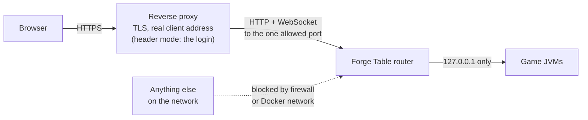
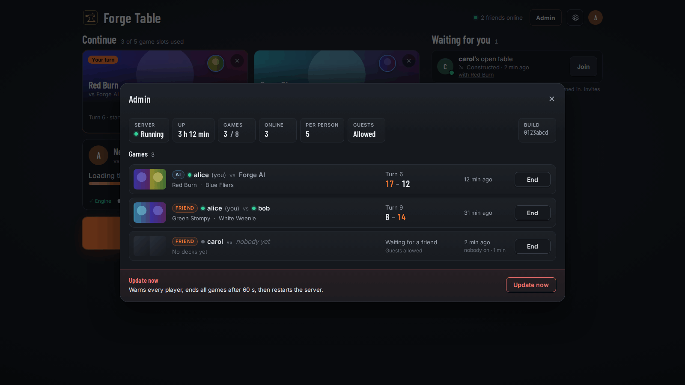

# Hosting for a group

The router serves everyone from one site: a lobby, each person's decks and games, and games between friends. First
decide who signs people in. `FT_AUTH` picks:

| `FT_AUTH` | Who signs people in | Read |
|---|---|---|
| `users` | Forge Table. It keeps its own accounts and has its own sign-in page. There's no sign-up: you make each account. | [Forge Table's own accounts](#forge-tables-own-accounts) |
| `oidc` | Your OpenID Connect provider, through a "Sign in with" button on Forge Table's sign-in page. Accounts are made on first sign-in. | [Sign in with OIDC](#sign-in-with-oidc) |
| `users,oidc` | Both, on one sign-in page. | both |
| `header` | A login proxy in front, which passes the user name in a header. Forge Table believes the header. | [A login proxy](#a-login-proxy) |

Unset, `FT_AUTH` is `header` when `FT_TRUST_PROXY_HEADER` is set, and otherwise `token`: one user on loopback, with
the link the server prints. That's the single-player setup, not this page.

With `users` and `oidc` the sign-in, the session cookie and the try limits are Forge Table's. With `header` they're
your proxy's, which makes the proxy and the network around the server's port the whole security story. Either way,
read this page to the end before you open a server to anyone.



## The reverse proxy

Every mode needs a reverse proxy in front for TLS. Your proxy has to do all of this. The examples further down do.

1. Terminate TLS. The `users` and `oidc` session cookie is `Secure`, so a browser only sends it over https.
2. Set a client-address header (for example `X-Real-IP`) from the real connection, overwriting whatever the client
   sent, if you use `users` or guests. Forge Table's try limits count per address, and behind a proxy every
   connection comes from the proxy. Never use `X-Forwarded-For` for this: a client can put anything at the front of
   that list.
3. Forward everything under one site to the router, with no path stripping or rewriting: `/`, `/api/*`, `/assets/*`,
   `/join/*`, `/m/<id>/*` (game pages, card images and the WebSocket at `/m/<id>/ws`) and, with guests, `/g/*`.
4. Keep the `Host` header, or set `X-Forwarded-Host`. The router compares the browser's `Origin` with it and refuses
   WebSocket upgrades and API writes from anywhere else.
5. Let WebSockets live long. Don't put a short read timeout on them.
6. Keep its upstream keep-alive under 150 seconds, which is when the router closes an idle connection. Caddy's
   default of 2 minutes is fine. Otherwise a reused connection that the router is closing turns a `POST` into a
   `502`.
7. Not route `/healthz` or `/admin/*`. The router refuses them from anything that isn't a local, unproxied request
   anyway.

One rule sits outside the proxy. Only the proxy may reach the router's port. In `header` mode whoever reaches it
directly can send any user header they like; in every mode they'd skip the proxy's client-address header, and with
it the try limits. Use a firewall rule (for example nftables accepting `ip saddr <proxy address> tcp dport 8790` and
dropping the rest) or a Docker network that holds only the proxy and Forge Table. Never publish the port with
`-p 8790:8790` or `ports:`.

The router does its part. It refuses to listen on a wildcard or public address, never passes browser cookies or
headers on to games, and its games only listen on `127.0.0.1`.

## Settings for every mode

| Setting | Needed? | Example |
|---|---|---|
| `FT_AUTH` | Yes, unless `FT_TRUST_PROXY_HEADER` implies `header` | `users`, `oidc`, `users,oidc` or `header` |
| `FT_BIND` | Yes, unless Docker sets it | `127.0.0.1` when the proxy is on the same host, else the host's private address |
| `FT_PORT` | Yes, so the proxy knows where to go | `8790` |
| `FT_DATA` | Recommended | `/var/lib/forge-table` |
| `FT_MAX_MATCHES` | Recommended | about (RAM - 2 GB) / 2 GB |
| `FT_REAL_IP_HEADER` | With `users` or guests | `X-Real-IP` |
| `FT_PUBLIC_URL` | With `oidc`, else optional | `https://forge.example.com` |
| `FT_REQUIRE_GROUP` | Optional, `oidc` or `header` | `forge-table` |
| `FT_ADMIN_GROUP` | Optional, `oidc` or `header` | `forge-table-admins` |
| `FT_GUESTS` | Optional | `true` |

Each mode's own settings are in its section below, and every setting is in the
[configuration reference](configuration.md).

## Forge Table's own accounts

`FT_AUTH=users` gives the router a sign-in page at `/auth/login` and keeps accounts in `<data>/forge-table.db`
(SQLite). There's no sign-up. Make the first account, an admin, from the command line on the machine that runs the
router, from inside the unzipped release:

```sh
java -cp "lib/*" forge.bridge.Main --users add ana --admin --data /var/lib/forge-table   # asks for the password
```

With Docker, run the same thing in the container:
`docker exec -it forge-table java -cp "lib/*" forge.bridge.Main --users add ana --admin --data /data`.

`--users` also takes `list`, `reset <login>`, `disable <login>`, `enable <login>`, `admin <login> on|off` and
`delete <login>`, and `add` takes `--name NAME` for the name other players see. It reads passwords from the
terminal, or from stdin when piped, never from a flag. It's safe to run while the router is up: a turned-off or
reset account is signed out on its next request. Logins are lowercase letters, digits, `.`, `_` and `-`, up to 32
characters; passwords are 10 to 256 characters.

What you set:

```sh
FT_AUTH=users
FT_REAL_IP_HEADER=X-Real-IP   # your proxy sets it from the real connection (Caddy: header_up X-Real-IP {remote_host})
```

The router refuses to start under `users` without `FT_REAL_IP_HEADER`. Five wrong passwords for one login in 10
minutes lock that login for 15 minutes, and 30 from one address lock the address, so without the real client
address one stranger could lock everyone out.

A sign-in lasts until it goes unused for 14 days, and 30 days at most (`FT_SESSION_IDLE_DAYS`,
`FT_SESSION_MAX_DAYS`). Passwords are stored as PBKDF2-HMAC-SHA256, and the database keeps only a hash of each
session id, so a copy of the file can't be used to sign in. Admins get the lobby's Admin section; `--users admin
<login> on` makes one.

On a LAN without TLS, `FT_INSECURE_COOKIES=true` sends the cookie without `Secure`. Then nothing overwrites the
client-address header either, so the per-address limit can be dodged; the per-login lock still holds. Don't do this
on anything that faces the internet.

## Sign in with OIDC

`FT_AUTH=oidc` puts a "Sign in with SSO" button on the sign-in page that sends people to your OpenID Connect
provider (Authentik, Keycloak, Authelia, Google and so on) and back. At the provider, make a confidential client
(an "OAuth2/OpenID provider" or "web application") with:

- **Redirect URI** `<FT_PUBLIC_URL>/auth/oidc/callback`, for example `https://forge.example.com/auth/oidc/callback`.
- **Post-logout redirect URI** `<FT_PUBLIC_URL>/auth/login`, if you use `FT_OIDC_LOGOUT=provider`.
- The `openid`, `profile` and `email` scopes, plus whatever puts the user's groups in a claim if you use
  `FT_REQUIRE_GROUP` or `FT_ADMIN_GROUP`.

Put the client secret in a file only the router's user can read, then:

```sh
FT_AUTH=oidc
FT_PUBLIC_URL=https://forge.example.com
FT_OIDC_ISSUER=https://idp.example.com/application/o/forge-table/
FT_OIDC_CLIENT_ID=forge-table
FT_OIDC_CLIENT_SECRET_FILE=/etc/forge-table/oidc-secret
```

The issuer must be exactly what the provider's `/.well-known/openid-configuration` says, trailing slash and all. The
log says at startup whether the provider answered. Forge Table uses the authorization code flow with PKCE, so a
public client with no secret works too: leave out `FT_OIDC_CLIENT_SECRET_FILE`.

The first sign-in makes an account named after the `preferred_username` claim (`FT_OIDC_LOGIN_CLAIM`) and links it
to the provider's subject, so a later rename at the provider keeps the same decks and games. If a Forge Table
account with that login already exists and isn't linked, the sign-in is refused rather than handing someone else's
account over. If it's the same person, the log line names the login, provider and subject for
`forge.bridge.Main --users link <login> <provider> <subject>`.

`FT_REQUIRE_GROUP` and `FT_ADMIN_GROUP` read the `groups` claim (`FT_OIDC_GROUPS_CLAIM`). The button's text is
`FT_OIDC_LABEL`. **Sign out** ends the Forge Table session only; `FT_OIDC_LOGOUT=provider` also signs out at the
provider. Use `FT_AUTH=users,oidc` to offer both the button and Forge Table's own accounts.

**Moving from a login proxy to OIDC** with the same provider keeps everyone's decks: set the OIDC settings, set
`FT_OIDC_LOGIN_CLAIM` to the claim that holds what the proxy sent (check one folder under `<data>/users/`), and set
`FT_LINK_BY_LOGIN=true` so each existing login is linked on its first OIDC sign-in. Then take the proxy's login away,
and turn `FT_LINK_BY_LOGIN` off once everyone has signed in.

## One router per site

Run one router for each site. The router makes a fresh key at startup to seal the short-lived cookie that carries an
OIDC sign-in from the button to the provider and back. It keeps accounts and sessions in its own data folder, and
counts wrong passwords in memory. Two routers behind one name, say behind a load balancer, would each refuse the
other's sign-ins and sessions, and a guesser would get a fresh count on each. A restart only fails the OIDC sign-ins
that were under way; signed-in sessions survive it. A second
channel (a `dev` next to `stable`) is a second site with its own name, data folder and provider client.

## A login proxy

`FT_AUTH=header` (or just `FT_TRUST_PROXY_HEADER`) has no accounts, passwords or sessions of its own. The router
believes whatever user name arrives in that header, and your proxy signs people in and sets it. On top of the
reverse proxy's job above, your proxy has to:

1. Sign people in, then set the user header (the one you name in `FT_TRUST_PROXY_HEADER`) on every request it
   forwards, WebSocket upgrades included.
2. Remove that header from what the client sent before setting it. The same goes for the name header and the groups
   header if you use them. If a client can send its own `X-Forwarded-User`, it can be anyone.

The router rejects a request whose user header is missing (`401`), repeated or empty (`400`).

| Setting | Needed? | Example |
|---|---|---|
| `FT_TRUST_PROXY_HEADER` | Yes | `X-Forwarded-User` |
| `FT_NAME_HEADER` | Optional | `X-Forwarded-Preferred-Username` |
| `FT_GROUPS_HEADER`, `FT_GROUPS_SEPARATOR` | With either group setting | `X-Forwarded-Groups` and `,` |
| `FT_LOGOUT_URL` | Optional, adds **Sign out** to the lobby | `/oauth2/sign_out` |

Group lists must arrive in exactly one header, names joined by the separator. Look at what your proxy actually
sends before you rely on groups; if it sends one header per group, the router answers `400`.

### Example: oauth2-proxy in front, Docker

Here oauth2-proxy is the reverse proxy itself. It signs people in with your OIDC provider and forwards to Forge
Table on a private Docker network. The whole stack is
[compose.yaml](../../forge-gui-bridge/docker/compose.yaml): copy it, replace the `example.com` URLs, register a
client called `forge-table` with your provider, and create `oauth2-proxy.env` next to it with
`OAUTH2_PROXY_CLIENT_SECRET` and `OAUTH2_PROXY_COOKIE_SECRET` (the file's header says how to make the cookie
secret). Then `docker compose up -d`, and put your usual TLS terminator in front of `127.0.0.1:4180`.

The parts that matter for security:

```yaml
  forge-table:
    networks: [table]             # no ports: only oauth2-proxy can reach it
  oauth2-proxy:
    command:
      - --upstream=http://forge-table:8790
    ports: ["127.0.0.1:4180:4180"] # your TLS terminator connects here
```

oauth2-proxy passes `X-Forwarded-User`, `X-Forwarded-Preferred-Username` and `X-Forwarded-Groups` to the upstream
by default (`--pass-user-headers`) and proxies WebSockets. Run the checks below to confirm that a client's own copies
of those headers don't get through on your version.

### Example: Caddy with Authentik

Caddy terminates TLS and asks an Authentik outpost about every request with `forward_auth`. Authentik names its
headers `X-authentik-username`, `X-authentik-name` and `X-authentik-groups`, and joins groups with `|`.

```caddyfile
forge.example.com {
	route {
		# a client's own X-Authentik-* headers never reach anything behind this line
		request_header -X-Authentik-*
		reverse_proxy /outpost.goauthentik.io/* http://authentik-outpost:9000
		forward_auth http://authentik-outpost:9000 {
			uri /outpost.goauthentik.io/auth/caddy
			copy_headers X-Authentik-Username X-Authentik-Name X-Authentik-Groups
			trusted_proxies private_ranges
		}
		reverse_proxy 192.168.1.20:8790
	}
}
```

The `route` block matters. Caddy normally runs `forward_auth` before `request_header`, which would delete the
headers Authentik just set; inside `route` the directives run in the order written.

Forge Table's settings for this setup:

```sh
FT_BIND=192.168.1.20            # this host's private address, firewalled to Caddy's address
FT_PORT=8790
FT_TRUST_PROXY_HEADER=X-authentik-username
FT_NAME_HEADER=X-authentik-name
FT_GROUPS_HEADER=X-authentik-groups
FT_GROUPS_SEPARATOR=|
FT_ADMIN_GROUP=forge-table-admins
```

## Guests and link previews

With `FT_GUESTS=true` a player can make a two-player invite link that also works for someone without a login. A
guest's browser only ever loads paths under `/g/`, where the only identity is the guest's own cookie for that one
game. Guests work in every sign-in mode and always need `FT_REAL_IP_HEADER`, set by your proxy from the real
connection. With `users` or `oidc` that's all. With a login proxy, the proxy also has to let `/g` and `/g/*` through
without its login and still strip the user headers there. In the Caddy example, add this at the top of the `route`
block, after `request_header`:

```caddyfile
		@guest path /g /g/*
		reverse_proxy @guest 192.168.1.20:8790 {
			header_up X-Real-IP {remote_host}
		}
```

and add the same `header_up` line to the last `reverse_proxy`. Then set `FT_GUESTS=true` and
`FT_REAL_IP_HEADER=X-Real-IP`. Guest limits (4 hours per guest, 5 joins per address per 10 minutes, 2 guest games at
once) are fixed in code.

Chat apps fetch an invite link to draw a preview. With `users` or `oidc` that just works: a signed-out visitor gets
the sign-in page, which carries the same preview tags. With a login proxy, let `/join/*`, `/og.png`, the favicons
and `/site.webmanifest` through without a login. For a request with no user header the router serves only the
static lobby page and icons on those paths. Either way the invite code is only checked when a signed-in user joins.

## Check it before you open it up

Run these from outside, against your public name. Each one must come out as stated.

With `users` or `oidc`:

```sh
# signed out, the API answers 401 and a page goes to the sign-in page
curl -si https://forge.example.com/api/matches | head -1
curl -si https://forge.example.com/ | grep -i '^location'      # /auth/login?next=...

# from another machine on the server's network (not the proxy), the port doesn't answer at all
curl -m 5 http://192.168.1.20:8790/api/matches
```

Then sign in with a browser and look at the cookie in its developer tools: `__Host-ft_session`, marked `Secure` and
`HttpOnly`. With `users`, also check that after five wrong passwords for one login the sign-in page says "Too many tries".

With a login proxy (use your own header names):

```sh
# a forged user header with no session never reaches the API: 302 to the login, or 401. Never 200.
curl -si -H 'X-Forwarded-User: mallory' https://forge.example.com/api/matches | head -1

# with a real session, a forged user header changes nothing: the answer's "user" is you, never mallory
curl -s -b '<your session cookie>' -H 'X-Forwarded-User: mallory' https://forge.example.com/api/matches

# a non-admin with a forged groups header is not an admin: 403
curl -s -o /dev/null -w '%{http_code}\n' -b '<non-admin session cookie>' \
  -H 'X-Forwarded-Groups: forge-table-admins' https://forge.example.com/api/admin/matches

# a WebSocket upgrade with a forged header and no session is refused: 302 or 401, never 101
curl -si -H 'Connection: Upgrade' -H 'Upgrade: websocket' -H 'Sec-WebSocket-Version: 13' \
  -H 'Sec-WebSocket-Key: dGhlIHNhbXBsZSBub25jZQ==' -H 'X-Forwarded-User: mallory' \
  https://forge.example.com/m/0/ws | head -1

# from another machine on the server's network (not the proxy), the port doesn't answer at all
curl -m 5 -H 'X-Forwarded-User: x' http://192.168.1.20:8790/api/matches
```

If you use `FT_REQUIRE_GROUP`, also check that a user outside the group who forges the groups header still gets
`403` from `/api/matches`.

## Sizing

Each game is its own JVM. At `-Xmx1536m` (the Docker image and the reference unit) a game typically uses 1.0 to
1.1 GB and can peak near 1.9 GB; the router itself needs about 0.25 GB. Without `FT_MAX_MATCHES` the cap is
`floor((RAM - 2048 MB) / 1536 MB)`, using the container's memory limit when there is one. `FT_GAME_MB=2048` makes the
cap strict, for example 3 games on 8 GB, 7 on 16 GB, 15 on 32 GB. CPU is rarely the limit; an AI decision is a burst
on one core. A game takes 20 to 40 seconds to start, mostly loading the card database.

## Health, drain and restarts

With `FT_ADMIN_PORT` set, the router also listens on `127.0.0.1:<admin port>`:

- `GET /healthz` answers `{"ok":true,"build":…,"active":N,"starting":N,"stopping":N,"draining":false,"cap":N}`.
  Counts only, no users or game ids. Requests carrying a forwarding header, the user header or an `Origin` get `403`.
- `POST /admin/drain` stops new games (the lobby says so). Saved games pick up again after the restart, so the
  router only waits for games with a guest: it exits with code 0 once none is left, or after `FT_DRAIN_TIMEOUT`
  minutes.



An admin's "Update now" in the lobby warns every open game for 60 seconds, ends the ones with a guest, and exits
with code 75. Every other game is saved and resumes after the restart.
Under systemd's `Restart=on-failure` or Docker's `restart: unless-stopped` the router comes straight back on
whatever build is installed. It doesn't download anything; installing a new build is up to you.

Logs go to standard error (the journal, or `docker logs`). Each game's own log is `<data>/matches/<id>/child.log`,
moved to `<data>/ended/<id>/` when the game ends.

## Reference systemd setup

[`forge-gui-bridge/deploy/`](../../forge-gui-bridge/deploy/) holds a working example. Treat it as a starting point.

| File | What it is |
|---|---|
| `forge-table@.service` | The router, one instance per channel (`forge-table@stable`). Runs the unpacked release in `/opt/forge-table/<channel>/current` as user `forge-table`, with `-Xmx1536m`, data in `/var/lib/forge-table/<channel>` and settings from `/etc/forge-table/<channel>.env`. |
| `forge-table.env.example` | A commented settings file for that unit. |
| `forge-table-deploy.sh` | Optional. Polls a JSON pointer, downloads and verifies a new zip, switches a `current` symlink and restarts the unit. On the `stable` channel it first waits until no game is running and drains the router; `dev` restarts at once. Keeps two releases. |
| `forge-table-deploy@.service`, `.timer` | Run the script every 5 minutes, as root because it restarts the unit. |

The deploy script expects a pointer you publish yourself. GitHub Releases don't provide one, so with plain releases
you install new builds by hand. What the script reads:

| Variable | Default | What it is |
|---|---|---|
| `FT_API` | none, required | Base URL. The stable pointer is `$FT_API/forge-table/latest/version.json`, the dev one `$FT_API/forge-table/dev/$FT_DEV_BRANCH/version.json`. It's a JSON object with at least `zip`, `zip_url`, `sha256` and `built_at`. |
| `FT_SIGNING_PUB` | none, required for `stable` | An Ed25519 public key (the base64 body of its PEM). A stable pointer must have `version.json.sig` next to it, the base64 signature over the pointer's exact bytes. An older `built_at` than the installed one is refused. |
| `FT_DEV_BRANCH` | `forge-table` | The dev channel's branch name in the pointer path. |
| `FT_ROOT` | `/opt/forge-table` | Where channels are installed. |
| token file, 2nd argument | | A line `GITLAB_READ_TOKEN=…`, sent as a `PRIVATE-TOKEN` header (a GitLab package-registry token). Empty means anonymous downloads. |

The script also reads `FT_ADMIN_PORT` from `/etc/forge-table/<channel>.env` to drain the router.
